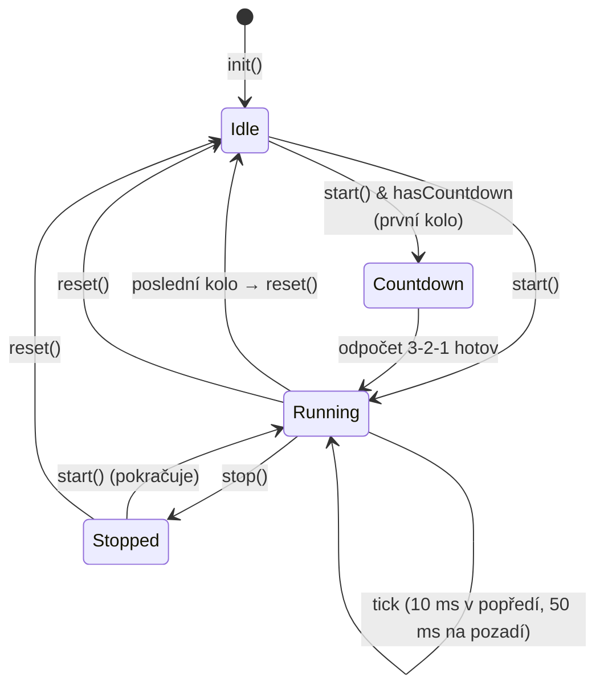
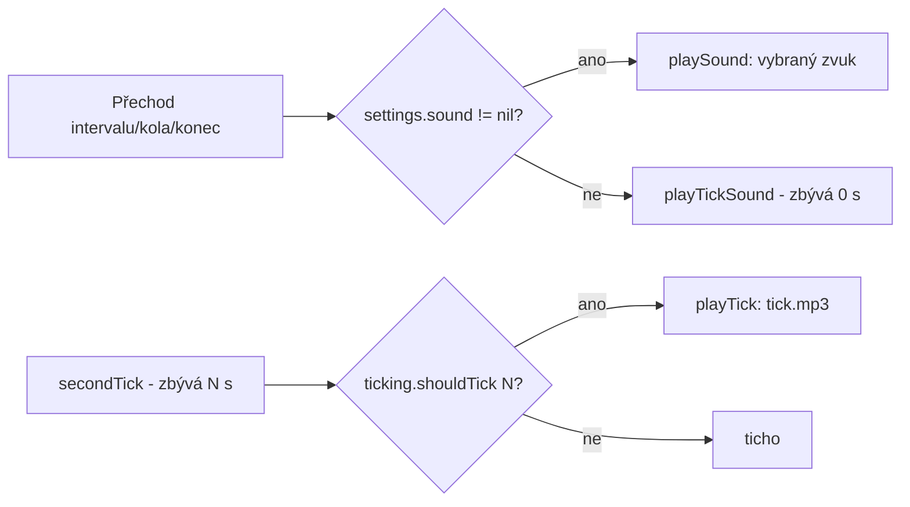

# GustavTimer 🏋️

> [!abstract] O čem to je
> **GustavTimer** je iOS aplikace (SwiftUI) pro **intervalové cvičení** – tzv. workout/HIIT timer. Uživatel si poskládá libovolný počet pojmenovaných intervalů (např. `Work 30s` → `Rest 15s`), nastaví počet kol (nebo nekonečnou smyčku) a aplikace ho provází tréninkem pomocí velkého odpočtu, vizuálních progress barů, zvukové a haptické zpětné vazby. Časovače lze ukládat mezi oblíbené, sdílet odkazem a vybírat z předpřipravených presetů (Tabata, EMOM, HIIT, AMRAP, meditace).

---

## Obsah

1. [[#1 · Základní informace]]
2. [[#2 · Architektura]]
3. [[#3 · TimerEngine – jádro odpočtu]]
4. [[#4 · Datový model a persistence]]
5. [[#5 · Hlavní obrazovka (TimerView)]]
6. [[#6 · Nastavení (SettingsView)]]
7. [[#7 · Oblíbené a předdefinované timery]]
8. [[#8 · Zvuky, tikání a haptika]]
9. [[#9 · Pozadí (Background)]]
10. [[#10 · Deep Linky]]
11. [[#11 · Onboarding a What's New]]
12. [[#12 · Hodnocení v App Store]]
13. [[#13 · Analytika (TelemetryDeck)]]
14. [[#14 · Lokalizace]]
15. [[#15 · Design systém (GustavUI)]]
16. [[#16 · Konfigurace (AppConfig)]]
17. [[#17 · Přehled klíčů UserDefaults]]
18. [[#18 · Mapa souborů]]
19. [[#19 · Běh na pozadí]]
20. [[#20 · Poznámky k implementaci a TODO]]
21. [[#21 · Vzdálený obsah (API)]]

---

## 1 · Základní informace

| Vlastnost | Hodnota |
|---|---|
| Název | GustavTimer |
| Bundle ID | `cz.daliborjanecek.GustavTimer` |
| Marketingová verze | **2.3.0** |
| Interní verze (`AppConfig.version`) | **201** |
| Cílová platforma | iOS (deployment target **18.0**, část konfigurací 16.4) |
| UI framework | **SwiftUI** |
| Persistence | **SwiftData** + `@AppStorage` (UserDefaults) |
| Jazyk | Swift 5.0 |
| URL scheme | `gustavtimerapp://` |
| Autor | Dalibor Janeček |

### Externí závislosti

| Balíček | Verze | Účel |
|---|---|---|
| **TelemetryDeck SwiftSDK** | 2.12.0 | Anonymní analytika (signály o používání) |
| **Lottie** (airbnb/lottie-ios) | 4.4.0+ | Vektorové animace ikon (přes GustavUI) |
| **rive-ios** | 6.11.1 | Historická závislost (viz [[#19 · Poznámky k implementaci a TODO]]) |
| **GustavUI** (lokální SPM balíček) | — | Sdílený design systém (barvy, fonty, komponenty, animace) |

> [!info] GustavUI balíček
> `GustavUI` je samostatný lokální Swift Package (`/git/GustavApps/GustavUI`) sdílený napříč aplikacemi Gustav (Timer, Weights, AtWork). Dělí se na dva produkty:
> - **GustavUICore** – barvy, fonty, layout, ikony, onboarding (iOS + watchOS).
> - **GustavUIAnimations** – Lottie animace (pouze iOS).
>
> Detaily v sekci [[#15 · Design systém (GustavUI)]].

---

## 2 · Architektura

Aplikace má **třívrstvou architekturu** s důrazem na sdílení čisté logiky:

```mermaid
flowchart TB
    subgraph Shared["🧠 Shared (čistá logika, žádné UIKit/SwiftUI)"]
        TE[TimerEngine]
        ID[IntervalData]
        SM[SoundModel]
        TDF[TimeDisplayFormat]
    end

    subgraph iOS["📱 iOS vrstva"]
        VM[TimerViewModel]
        TV[TimerView]
        SV[SettingsView]
        FV[FavouritesView]
        SND[SoundManager]
        AC[AppConfig]
        AP[AppPreferences]
    end

    subgraph Persist["💾 Persistence"]
        SD[(SwiftData<br/>TimerData, CustomImageModel)]
        UD[(UserDefaults<br/>@AppStorage)]
    end

    subgraph GustavUI["🎨 GustavUI balíček"]
        Core[GustavUICore<br/>barvy, fonty, komponenty]
        Anim[GustavUIAnimations<br/>Lottie]
    end

    TV --> VM
    SV --> VM
    VM --> TE
    TE --> ID
    VM --> SND
    SND --> SM
    VM --> SD
    VM --> UD
    SV --> SD
    iOS --> GustavUI
```

### Princip: engine nic neví o platformě

`TimerEngine` (ve složce `Shared/`) je **mozek** aplikace – řídí odpočítávání, přepínání intervalů a kol. **Neimportuje UIKit, SwiftUI ani AVFoundation.** Místo toho oznamuje události přes **callbacky**, které si každá platforma napojí po svém:

```swift
engine.onFeedback = { feedback in ... }  // zvuk/vibrace
engine.onStart    = { ... }              // např. vypnutí idle timeru
engine.onStop     = { ... }              // např. zapnutí idle timeru
```

Díky tomu je stejný engine použitelný i na **Apple Watch** (kód je na to připravený – komentáře přímo popisují watchOS napojení).

### Tok dat

- **`TimerView`** zobrazuje stav a deleguje akce na **`TimerViewModel`**.
- **`TimerViewModel`** je iOS-specifická obálka nad `TimerEngine` – přidává SwiftData persistenci, odkazy a analytiku. Vibrace a zvuky pouští přes `TimerFeedbackPlayer`. O vzhledu view neví nic: animace ikon ani sheety neřídí, jen dává vědět počítadly `intervalPulse` / `roundPulse` a callbackem `onPresentSheet`. Přeposílá `engine.objectWillChange` do vlastního `objectWillChange`, takže SwiftUI se překresluje na změny enginu.
- **`SettingsView`** a **`FavouritesView`** jen kreslí. Úpravy aktivního timeru (`TimerData` s `order == 0`), ukládání do oblíbených a analytiku dělá sdílený **`SettingsViewModel`**; limity úprav (počet intervalů, délky názvů) hlídá model v `TimerData+Editing.swift`. Seznam oblíbených si views drží přes `@Query` a ViewModelu ho předávají. Po zavření Settings `TimerView` znovu načte data a resetuje timer.

---

## 3 · TimerEngine – jádro odpočtu

`Shared/TimerEngine.swift` je `ObservableObject`. Tiká **každých 10 ms** přes asynchronní `Task` s `ContinuousClock` (přesné časování i při zátěži CPU).

### Životní cyklus



### Klíčový publikovaný stav (`@Published private(set)`)

| Property | Typ | Význam |
|---|---|---|
| `isRunning` | `Bool` | Zda timer běží |
| `isCountingDown` | `Bool` | Probíhá úvodní odpočet 3-2-1 |
| `countdownValue` | `Int` | Aktuální hodnota odpočtu |
| `activeTimerIndex` | `Int` | Index právě běžícího intervalu |
| `finishedRounds` | `Int` | Počet dokončených kol (1-based; 0 = nespuštěno) |
| `remainingTime` | `Duration` | Zbývající čas v intervalu (sub-sekundová přesnost) |
| `intervals` | `[IntervalData]` | Pole intervalů tvořící jedno kolo |

### Konfigurace

- `maxTimers` – max. počet intervalů v kole (v appce **10**).
- `maxCountdownValue` – max. délka intervalu (v appce **600 s**).
- `countdownDuration` – délka úvodního odpočtu (**3 s**).
- `rounds` – počet kol; **`-1` = nekonečná smyčka**.
- `hasCountdown` – zda zobrazit úvodní odpočet 3-2-1 před prvním kolem.

### Vypočítané hodnoty

- **`count`** – zbývající celé sekundy (oříznuto délkou intervalu).
- **`progress`** – pokrok intervalu `0.0–1.0` (počítáno z milisekund kvůli plynulé animaci).
- **`timeRatio(for:)`** – poměr délky intervalu vůči celému kolu (pro šířku segmentů v progress baru).
- **`formattedCurrentTime(format:)`** – formátovaný čas dle `TimeDisplayFormat`.

### Události (`TimerFeedback`)

Engine při určitých momentech zavolá `onFeedback(...)`:

| Případ | Kdy nastane | Typické napojení v iOS |
|---|---|---|
| `.intervalTransition` | Přechod na další interval (Work → Rest) | Lehká vibrace + zvuk + Lottie ikona |
| `.roundComplete` | Dokončení celého kola, začíná další | Success vibrace + zvuk + loop ikona |
| `.timerEnd` | Poslední kolo dokončeno (engine se resetuje) | Error vibrace + zvuk + počítadlo dokončení |
| `.countdownTick` | Každý tik úvodního odpočtu (3, 2, 1) | Lehká vibrace |
| `.countdownEnd` | Konec úvodního odpočtu, timer startuje | Výraznější vibrace |
| `.secondTick(remainingSeconds:)` | Každá změna zobrazené sekundy (1×/s), nese zobrazenou hodnotu | Zvukové „tikání" podle `TickingMode` |

### Logika přechodů

- **`tick(_:silent:)`** odečte **skutečně uplynulý čas** (měřený `ContinuousClock`, ne počtem tiků) a provede všechny přechody, které se do něj vejdou. Zbytek času se přelévá do dalších intervalů, takže i jeden velký skok (aplikace byla uspaná) skončí na správné pozici. `silent` potlačí pípání a vibrace, aby se při dohánění času nespustila jejich salva.
- **`switchToNextInterval()`** – posune `activeTimerIndex`. Pokud je za koncem pole → `handleRoundCompletion()`. **Nulové intervaly (0 s) se automaticky přeskakují.**
- **`handleRoundCompletion()`**:
  1. `rounds == -1` (nekonečno) → nové kolo,
  2. `finishedRounds < rounds` → nové kolo,
  3. `finishedRounds == rounds` → konec + reset.

### Ovládací metody

| Metoda | Akce |
|---|---|
| `start()` / `stop()` / `startStop()` | Spuštění / zastavení (bez resetu pozice) |
| `reset()` | Návrat na první interval, první kolo |
| `skipCurrentInterval()` | Přeskočí aktuální interval (nastaví remaining na 0) |
| `syncToWallClock()` | Dorovná stav podle reálného času (po návratu z pozadí) |
| `setTickInterval(_:)` | Jak často se probouzí smyčka (10 ms v popředí, 50 ms na pozadí) |
| `addInterval(_:)` | Přidá interval (pokud není dosaženo `maxTimers`) |
| `removeInterval(at:)` | Odebere interval (index nebo `IndexSet`) |
| `loadIntervals(_:resetState:)` | Nahraje nové intervaly z persistence |

---

## 4 · Datový model a persistence

### SwiftData modely

#### `TimerData` (`@Model`)
Hlavní entita časovače. Ukládá se přes SwiftData.

| Pole | Typ | Poznámka |
|---|---|---|
| `id` | `UUID` | Identifikátor |
| `name` | `String` | Název časovače |
| `intervals` | `[IntervalData]` | Pole intervalů (default Work 30s / Rest 15s) |
| `rounds` | `Int` | Počet kol (`-1` = smyčka) |
| `selectedSound` | `SoundModel?` | Zvuk (`nil` = ztlumeno) |
| `isVibrating` | `Bool` | Haptika |
| `tickingMode` | `TickingMode?` | Režim tikání (`nil` = timer uložený před zavedením režimů, odvodí se z `isTicking`). Číst/zapisovat přes `ticking` |
| `isTicking` | `Bool` | Původní zapnuto/vypnuto tikání (default `false`); drží se v souladu s `tickingMode` |
| `hasCountdown` | `Bool` | Úvodní odpočet 3-2-1 (default `true`) |
| `order` | `Int` | **Klíčové pole** – řadí a rozlišuje časovače |
| `createdAt` | `Date` | Datum vytvoření |
| `usedCount` | `Int` | Kolikrát byl použit |
| `lastUsed` | `Date?` | Naposledy použit (řazení oblíbených) |
| `sourceID` | `UUID?` | Jen hlavní timer: `id` oblíbeného, ze kterého vznikl (`nil` = preset, odkaz, nový). Viz [[#Uložené (Saved) timery]] |

> [!important] Význam `order`
> - **`order == 0`** → **aktivní (hlavní) časovač**, který právě běží na hlavní obrazovce. Vždy existuje právě jeden.
> - **`order > 0`** → **uložené oblíbené** časovače (vyšší = novější).
> - **`order < 0`** → historicky předdefinované presety. Od verze 2.4 presety `TimerData` vůbec nejsou – jsou to hodnoty `TimerSettings` v enumu `PredefinedTimer` a `TimerData` z nich vznikne, až si je uživatel uloží mezi oblíbené.
>
> Jestli je aktivní časovač uložený, se pozná podle `sourceID` (`FavouriteTimers.state`), ne porovnáním. `matchesWorkout(of:)` (celé nastavení kromě názvu) slouží jen k označení vybraného presetu a k analytice (`Analytics.origin`).

#### `CustomImageModel` (`@Model`)
Jednoduchý model držící `Data` vlastní fotky uživatele použité jako pozadí.

### `IntervalData` (sdílený struct)
Základní stavební blok – `Identifiable, Codable, Equatable`.

| Pole | Typ | Poznámka |
|---|---|---|
| `id` | `UUID` | Pro SwiftUI `ForEach` (mimo `Equatable`) |
| `value` | `Int` | Délka v **celých sekundách** (0–600) |
| `name` | `String` | Název (max 12 znaků – `AppConfig.maxTimerName`) |
| `duration` | `Duration` | Computed nad `value` (pro engine) |

Je `Codable` → serializuje se pro SwiftData, sdílení odkazem i případný přenos na Watch. Rovnost ignoruje `id` (porovnává `value` + `name`).

### Persistence – jak to funguje

- **`@modelContainer(for: [CustomImageModel.self, TimerData.self])`** se nastavuje v `GustavTimerApp`.
- Hlavní časovač zakládá **jediná metoda** `TimerData.mainTimer(in:)`. Je idempotentní (fetch vidí i nezapsané změny v kontextu), takže nevadí, že se `ContentView` a `TimerView` při startu potkávají v nedefinovaném pořadí.
- `TimerViewModel` čte a zapisuje celé nastavení přes `TimerData.settings`.
- **Od verze 2.4 je nastavení timeru výhradně ve SwiftData.** V UserDefaults zůstávají jen nastavení zařízení – viz [[#17 · Přehled klíčů UserDefaults]]. Přesun dělá jednorázově `SettingsMigration`.

### `TimerSettings` (sdílený struct)

Kompletní nastavení timeru jako hodnotový typ (`Shared/TimerSettings.swift`) – jediná definice toho, „co je timer": `name`, `intervals`, `rounds`, `sound`, `isVibrating`, `ticking`, `hasCountdown`.

`ticking: TickingMode` – `.off` (bez tikání), `.everySecond` (každou sekundu), `.finalSeconds` (jen poslední 3 sekundy intervalu). Jestli tik zazní, rozhoduje `TickingMode.shouldTick(remainingSeconds:)`.

`TimerData` je nad ním tenká obálka: `timerData.settings` čte i zapisuje **celé** nastavení naráz, takže nikde v aplikaci není místo, které by kopírovalo nastavení po polích (a mohlo tedy na některé zapomenout).

```swift
mainTimer.settings = favourite.settings   // výběr oblíbeného
let merged = link.applied(to: mainTimer.settings)   // sdílený odkaz
```

> `sound: SoundModel?` je **jediná** reprezentace zvuku, `nil` = ztlumeno. Samostatný `isSoundEnabled` do verze 2.3 tutéž informaci duplikoval.

---

## 5 · Hlavní obrazovka (TimerView)

`Views/Timer/TimerView.swift` – první obrazovka po startu.

### Rozložení – Portrait

```
┌─────────────────────────────┐
│  ▓▓▓▓▓ ░░░░  (ProgressArray) │  ← segmenty intervalů
│  Work (3/8)          ⟳🔊 EDIT │  ← header: název + kolo + ikony + nastavení
│                              │
│            45                │  ← velký odpočet (swipe: 45 ↔ 0:45)
│                              │
│   [ START ]   [ ⟲ reset ]    │  ← ovládací tlačítka
└─────────────────────────────┘
```

- **`ProgressArrayView`** – řada `ProgressBar` segmentů, šířka každého podle podílu intervalu na délce celého kola. Dostává jen intervaly, index aktivního a jeho průběh, ne celý ViewModel. Aktivní segment ukazuje `progress`, dokončené jsou plné, budoucí prázdné.
- **Header** – název aktuálního intervalu + `finishedRounds/rounds` (u smyčky bez jmenovatele). Vedle animované ikony stavu (smyčka / vibrace / zvuk) přes `GustavAnimationView` (Lottie) a tlačítko **EDIT** → otevře Settings.
- **Odpočet** – `Text` s fontem `.timerCounter` (MartianMono-Bold, 800 pt, `minimumScaleFactor 0.01`), barva `gustavVolt`. Odpočet je stránkovaný `TabView` (`.page`, bez teček) – **swipe** listuje s animací mezi celými sekundami (`.seconds`, výchozí stránka) a minutami:sekundami (`.minutesSeconds`). Přepnutí potvrdí haptika `.selection`. **Tap** na odpočet spustí/zastaví timer, **dvojtap** přeskočí interval (jen za běhu, stejně jako tlačítko Skip). Jednoduchý tap čeká, jestli nepřijde druhý, takže reaguje se zpožděním asi 0,3 s.
- **Tlačítka** – `startStopButton` + `secondaryButton`.

### Rozložení – Landscape

Zjednodušší – **jen velký odpočet** uprostřed, výchozí ve formátu `minutesSecondsHundredths` (přesnost na setiny pro závodníky). **Swipe** přes odpočet listuje stejně jako na výšku na druhou stránku s celými sekundami, **tap kdekoli** = start/stop, **dvojtap** = skip. Progress bar a header jsou skryté.

> Formát se pamatuje pro každou orientaci zvlášť (`portraitTimeDisplayFormat`, `landscapeTimeDisplayFormat`).

> Orientace se sleduje přes `UIDevice.orientationDidChangeNotification`.

### Tlačítka

- **Start/Stop** (`ControlButton`):
  - Před prvním startem s povoleným odpočtem → label `COUNTDOWN`.
  - Během běhu → `STOP` (barva `gustavPink`).
  - Jinak → `START` (barva `gustavVolt`) + popis = název prvního intervalu.
- **Countdown tlačítko** (`CountdownStartButton`) – během úvodního odpočtu zobrazuje `3 → 2 → 1` s animovanou výplní (lineární progress).
- **Sekundární tlačítko** – během běhu **Skip** (přeskoč interval), jinak **Reset**. Animace přechodu řeší Lottie segmenty (`clickSkip`, `clickReset`, `transitionToSkip`, `transitionToReset`).

### Always-on display

Při startu engine zavolá `onStart` → `UIApplication.shared.isIdleTimerDisabled = true` → **displej během cvičení nezhasne**. Při stopu se idle timer zase povolí.

---

## 6 · Nastavení (SettingsView)

`Views/Settings/SettingsView.swift` – modální `sheet` s `NavigationStack` a `List`. Edituje hlavní časovač (`order == 0`) **přímo v SwiftData**.

### Sekce

| Sekce | Obsah |
|---|---|
| **Banner** | `SettingsBannerView`: platné bannery z API (víc = `TabView` s automatickým přepínáním), jinak náhodný vestavěný obrázek z výzvy (CHALLENGE) → YouTube video. Viz [[#21 · Vzdálený obsah (API)]] |
| **Intervaly** | Editovatelný seznam intervalů (`IntervalRowView`): název + hodnota, drag-to-reorder, swipe-to-delete, „+ Add interval". Footer ukazuje souhrn (délka kola, příp. celkový čas) |
| **Rounds** | `NavigationLink` → `RoundsSettingsView` (smyčka / 1–31 kol) |
| **Favourites** | Náhled posledních 3 oblíbených + odkaz na všechny |
| **Feedback** | Toggle Haptika, Toggle Úvodní odpočet, menu Tikání (vypnuto / každou sekundu / před koncem intervalu – poslední 3 s), výběr Zvuku |
| **Appearance** | `NavigationLink` → `BackgroundSelectorView` |
| **More** | Odkazy z API, pak Hodnotit a Navrhni funkci. Vestavěné Gustav Weights, Instagram a YouTube jen když z API žádný platný odkaz není |
| *(jen DEBUG)* | Číslo verze – 5× klepnout = vývojářské menu vzdáleného obsahu |

### Toolbar

- **✕** zavřít (na iOS 26+ `role: .close`).
- **☆ / ★** podle stavu uložení (`FavouriteTimers.SaveState`):
  - ☆ *neuloženo* → dialog s názvem, uloží jako nový oblíbený,
  - ★ *uloženo* → menu Přejmenovat / Odebrat z oblíbených,
  - ★• *upraveno* (tečka) → menu Uložit změny do „X“ / Uložit jako nový… / Vrátit uložené.
  Stav je i textem pod názvem timeru.
- **+** přidat interval (pokud není dosaženo limitu 10).
- **slider** přepnout edit mód (reorder/delete).

### Detaily editace intervalu (`IntervalRowView`)

- Pole **název** (`submitLabel .done`) a **hodnota** (numerická klávesnice).
- Hodnota se filtruje na číslice a při potvrzení se **ořízne do rozsahu 1–600** (`commitValue()`).
- Název se ořezává na 12 znaků.

### Skrytí klávesnice

`DismissKeyboardOnTap` (vlastní `UIViewRepresentable`) přidá na okno tap gesture, který skryje klávesnici – ale **chytře ignoruje tapy na `UITextField`** (oprava double-tap problému, viz git historie).

### Souhrn (footer intervalů)

`summaryText` spočítá délku jednoho kola a – pokud `rounds > 1` – i celkový čas tréninku. Formátuje přes `Int.asTime()` (např. `1m 30s`, `1h 05m 00s`).

---

## 7 · Oblíbené a předdefinované timery

`Views/Settings/FavouritesView.swift`

### Uložené (Saved) timery
Všechny operace s oblíbenými jsou v `Models/FavouriteTimers.swift`.

Hlavní timer (`order == 0`) je **pracovní kopie**. Načtením oblíbeného si zapamatuje jeho `id` v `sourceID`. Úpravy se do oblíbeného **nepropisují samy**, takže jednorázová úprava na jeden trénink oblíbený nepřepíše. Stav:

| Stav | Kdy |
|---|---|
| `.unsaved` | `sourceID == nil` (preset, odkaz, nový timer) nebo zdroj mezitím smazaný |
| `.saved(fav)` | nastavení se shoduje se zdrojem **celé, i s názvem** |
| `.modified(fav)` | nastavení se od zdroje liší, i jen zvukem, haptikou, tikáním, odpočtem nebo názvem |

- *Uložit změny* zapíše nastavení do zdroje, *Vrátit uložené* ho vezme zpět, *Uložit jako nový* založí oblíbený a přepne `sourceID` na něj.
- Preset a odkaz `sourceID` vynulují. Úprava v nastavení ho nechává, takže se ukáže jako úprava.
- Instalace z doby před `sourceID`: při startu se hlavní timer propojí s oblíbeným, který se s ním shoduje úplně (`linkLegacySource`).

- Filtr `order > 0`, řazené dle `order` sestupně.
- Tap → **načte** časovač (`FavouriteTimers.load`: zkopíruje data do hlavního, nastaví `sourceID`, zvýší `usedCount`, nastaví `lastUsed`). Vybraný je ten, ze kterého hlavní timer vznikl; s neuloženými úpravami má štítek „Upraveno“.
- **+** v toolbaru vždy uloží aktivní timer jako nový oblíbený.
- Swipe (leading) → **ShareLink** s deep-link URL (sdílení časovače).
- Swipe (trailing) / edit mód → smazat, drag → přeřadit (přepočítá `order`).
- Prázdný stav → `FavouritesEmptyView`.

### Předdefinované (Preloaded) timery
Z enumu `PredefinedTimer` (každý case nese `settings: TimerSettings` a tři tipy):

| Preset | Kola | Intervaly | Zvuk | Vibrace |
|---|---|---|---|---|
| **5 min meditace** | smyčka | Meditation 300 s | gong | ne |
| **Tabata** | 8 | Work 20 s / Rest 10 s | bicycle | ano |
| **EMOM 10 min** | 10 | Work 60 s | whistle | ano |
| **HIIT** | 10 | Sprint 30 s / Rest 15 s | whistle | ano |
| **AMRAP** | 20 | Max 60 s | beep | ano |

Každý preset má 3 lokalizované **tipy** (`description[0..2]`), zobrazuje se náhodný.

### `FavouriteRowView`
Vykresluje řádek časovače – mini progress bary jednotlivých intervalů (šířka dle poměru), název, štítek „Upraveno“ (`isModified`), ikony stavu (smyčka/zvuk/vibrace) a volitelný tip. Hlavní časovač (`order == 0`) má label `CURRENT_TIMER` a poloprůhledný název.

---

## 8 · Zvuky, tikání a haptika

### `SoundManager` (singleton)
`Managers/SoundManager.swift` – přehrává MP3 přes `AVAudioPlayer`.
- Audio session: kategorie `.playback` s `.mixWithOthers` → **nepřeruší hudbu na pozadí**.
- `playSound(soundModel:)` – přehraje vybraný zvuk při přechodu.
- `playTick()` – přehraje `tick.mp3` (tikání podle `TickingMode`).

### Dostupné zvuky (`SoundModel`)
Enum (`Shared/SoundModel.swift`), každý case = MP3 v bundle:

| Case | Soubor | Lokalizovaný název |
|---|---|---|
| `beep` | beep.mp3 | BEEP |
| `squeeze` | squeeze.mp3 | RUBBER_DUCK |
| `whistle` | whistle.mp3 | WHISTLE |
| `hey` | hey.mp3 | HEY |
| `game` | game.mp3 | GAME |
| `retro` | retro.mp3 | RETRO |
| `bicycle` | bicycle.mp3 | BICYCLE |
| `gong` | gong.mp3 | GONG |
| `bell` | bell.mp3 | BELL |
| `bubble` | bubble.mp3 | BUBBLE |

> Lokalizovaný název (`title`) je v iOS-only rozšíření `SoundModel+Title.swift`. Samotný enum je čistý Foundation (sdílitelný s Watch).

### Logika přehrávání (v `TimerFeedbackPlayer`)

Co se má při které události enginu stát, rozhoduje čistá funkce `TimerFeedbackPlayer.effects(for:settings:isRunning:)` – vrací seznam vibrací a zvuků a pokrývá ji `TimerFeedbackPlayerTests`. `play` ten seznam jen provede.



`shouldTick`: `.off` nikdy, `.everySecond` vždy, `.finalSeconds` jen při N ≤ 3 (tedy 3, 2, 1 a při ztlumeném zvuku i na přechodu).

### Haptika
Podmíněno `isVibrating`:
- **Přechod intervalu / countdown tick** → `UIImpactFeedbackGenerator(.light)`.
- **Konec kola / countdown end** → `UINotificationFeedbackGenerator(.success)`.
- **Konec timeru** → `UINotificationFeedbackGenerator(.error)`.

### Úvodní odpočet (Countdown)
Per-timer volba `TimerData.hasCountdown` (Toggle „Úvodní odpočet" v Settings). Pokud zapnuto, před **prvním** kolem proběhne odpočet **3-2-1** s vibrací/animací.

---

## 9 · Pozadí (Background)

`Views/Timer/SubViews/BackgroundImageView.swift` + `Views/Settings/SubViews/BackgroundSelectorView.swift`

- **10 vestavěných obrázků** (`AppConfig.backgroundImages`): Benchpress, Boxer, Ground, Lanes, Poster, Pullup, Squat, Wood, Buddha, Lotos.
- Všechna pozadí jsou **černobílá** (`.grayscale(1.0)`) s tmavým overlayem (`Color.black.opacity(0.3)`) – aby vynikl odpočet.
- Uživatel může vybrat **vlastní fotku** z knihovny (`PhotosPicker`) – uloží se jako `CustomImageModel` do SwiftData. Aktuálně se drží **jedna** vlastní fotka (při výběru nové se staré smažou).
- Výběr se ukládá do `@AppStorage("bgIndex")`. Hodnota **`-1`** = vlastní fotka, `0..9` = vestavěný obrázek.
- **Stažená pozadí** z API jsou ve výběru před vestavěnými. Pamatují se podle ID v `remoteBackgroundID` (index by se se změnou API posunul), `bgIndex` je přitom `0`. Když vybrané vzdálené pozadí přestane platit nebo zmizí z API, `RemoteContentManager` smaže `remoteBackgroundID` a zůstane vestavěné pozadí 0. Viz [[#21 · Vzdálený obsah (API)]].

---

## 10 · Deep Linky

Aplikace reaguje na URL scheme **`gustavtimerapp://`** (registrováno v `Info.plist`). Zpracování v `TimerViewModel.handleDeepLink(url:)`.

### Hosty

| Host | Akce |
|---|---|
| `whatsnew` | Otevře obrazovku What's New |
| `timer` | Načte časovač z query parametrů a otevře Settings |

### Formát `timer` deep-linku

**Intervaly:**
- **Plný formát** `nazev=hodnota` → pojmenovaný interval (hodnota 1–600 s).
- **Minimalistický formát** `hodnota` (jen číslo bez `=`) → interval pojmenovaný `Kolo N`.
- Max **10** intervalů (přebytek se ignoruje).

**Nastavení timeru:**

| Klíč | Hodnota | Význam |
|---|---|---|
| `rounds` | `-1` nebo `1…31` | Počet kol, `-1` = smyčka |
| `_title` | text, max 64 znaků | Název timeru |
| `_sound` | `beep`, `gong`, … nebo `off` | Zvuk přechodu, `off` = ticho |
| `_vibe` | `1` / `0` | Vibrace |
| `_tick` | `0` / `1` / `3` | Tikání: `0` vypnuto, `1` každou sekundu, `3` poslední 3 sekundy |
| `_cd` | `1` / `0` | Úvodní odpočet 3-2-1 |

Booleany (včetně `_tick`) berou i `true/false`, `yes/no`, `on/off` (odkazy se píšou i ručně); generátor zapisuje `1`/`0` (u `_tick` i `3`). Starší verze aplikace `_tick=3` nerozumí a nechají si vlastní tikání. U každého klíče vyhrává **první výskyt**, nesrozumitelná hodnota se ignoruje.

> [!important] Chybějící parametr = zachovej současné
> Na tomhle pravidle stojí celá zpětná kompatibilita. Odkaz z verze 2.2/2.3 neobsahuje `_sound` ani `_vibe`, takže **nesáhne na nastavení příjemce** – chová se přesně jako dřív. Nové odkazy nesou všechno explicitně.
>
> Proto generátor zapisuje nastavení **vždy**, i když odpovídá výchozím hodnotám: jinak by příjemce zdědil vlastní hodnotu a poslaný trénink by u něj zněl jinak.
>
> Výjimkou je `rounds` – chybí-li, je `-1`. Tak se odkazy chovaly od začátku.

Slučování drží jediná funkce `SharedTimerLink.applied(to:)`:

```swift
let merged = link.applied(to: mainTimer.settings)
```

Neznámý zvuk (odkaz z novější verze aplikace) se ignoruje – **nesmí** skončit ztlumením.

### Příklady

```
https://gustavtraining.com/t?Work=20&Rest=10&rounds=8&_sound=bicycle&_vibe=1&_tick=0&_cd=1&_title=TABATA
gustavtimerapp://timer?Work=30&Rest=15&rounds=8   (odkaz z 2.2.1, nastavení zůstane příjemci)
gustavtimerapp://timer?60&30&60&30                (minimalistický → Kolo 1..4)
gustavtimerapp://timer?Sprint=20&Rest=10          (smyčka, rounds chybí → -1)
gustavtimerapp://whatsnew
gustavtimerapp://settings/background              (otevře nastavení → Výběr pozadí)
```

### Odkazy na obrazovky

`gustavtimerapp://settings/<obrazovka>` otevře nastavení a v něm obrazovku z výčtu `AppScreen` (`Shared/SharedTimerLink.swift`). Teď jen `background` (Výběr pozadí). Funguje z banneru i zvenku (Safari, Poznámky, push).

1. `SharedTimerLink.route` → `.screen(AppScreen)`, `TimerViewModel.handleDeepLink` → `AppNavigator.shared.open(screen)`.
2. `TimerView` na požadavek otevře sheet nastavení (když už otevřený není). Otevření nastavení zastaví běžící timer, stejně jako ruční otevření.
3. `SettingsView` si požadavek převezme (`AppNavigator.consume()`) při zobrazení nebo hned, když je otevřené, a nastaví `NavigationStack(path:)` na `[screen]`. Zpět vede do kořene nastavení.

Nová obrazovka = nový `case` v `AppScreen`, větev v `navigationDestination(for: AppScreen.self)` v `SettingsView` a položka v `gtimer_app_screens()` v pluginu webu. Neznámá obrazovka (odkaz pro novější verzi) se bere jako cizí odkaz.

> [!tip] Sdílení
> **ShareLink** generuje přesně takové URL na třech místech: v toolbaru `SettingsView` (právě rozdělaný timer) a swipem na řádku oblíbeného či presetu ve `FavouritesView`. Limity drží `AppConfig.sharedLinkLimits`. Odkaz na timer se nenačte hned – zvenku (Universal Link, `gustavtimerapp://timer`) ani z banneru v aplikaci: aplikace se nejdřív zeptá alertem „Načíst timer?“ s názvem a popisem timeru (`SharedTimerLink.summary`, např. `Work 0:40 · Rest 0:20 · 4×`). Čekající odkaz drží `TimerViewModel.pendingSharedLink`, alert ukazuje `SharedLinkPrompt` (`AppLinkRouter.swift`) jako UIKit alert nad nejvrchnějším view controllerem, takže se objeví i nad otevřeným nastavením. Po **Načíst** se timer nahraje a otevře se nastavení, po **Zrušit** se nic nezmění (běžící trénink běží dál). Odkaz bez platného intervalu se na nic neptá. Dřívější hlášku „Nový timer nastaven“ po načtení nahradilo tohle potvrzení.

---

## 11 · Onboarding a What's New

`Views/Onboarding/OnboardingView.swift`

- Postavený na `GustavOnboardingView` z balíčku GustavUI; 3 stránky s videem:
  1. **Timer** (`ob_timer.mp4`) – jak funguje časovač.
  2. **Favourites** (`ob_favourites.mp4`) – oblíbené.
  3. **Gustav** (`ob_fristensky.mp4`) – o značce, s tlačítkem dokončení.
- Onboarding se zobrazí, když `lastOnboardingVersion != AppConfig.onboardingVersion` (řízeno v `ContentView`).
- **What's New** používá tutéž `OnboardingView` (zobrazí se přes `showWhatsNew` nebo deep-link `whatsnew`). Verze hlídá `whatsNewVersion < AppConfig.version`.

---

## 12 · Hodnocení v App Store

- `TimerViewModel` počítá dokončené timery v `@AppStorage("completedTimerCount")`.
- Po každém **5.** dokončeném timeru (`completedTimerCount % AppConfig.reviewPromptInterval == 0`) se po 1,5 s zavolá `onReviewRequested` → SwiftUI `requestReview` (StoreKit nativní dialog hodnocení).
- Odkaz „Hodnotit" v Settings vede na `AppConfig.reviewURL` (přímo write-review).

---

## 13 · Analytika (TelemetryDeck)

Inicializace v `GustavTimerApp.init()` (App ID `E2CAE467-…`). Všechny signály jdou přes `Analytics` (`Managers/Analytics.swift`): názvy jsou v `AnalyticsSignal`, parametry skládají čisté funkce testované v `AnalyticsTests`. Uživatelem psané názvy (timer, intervaly) se nikdy neposílají, název jde jen u presetů.

**Parametry nastavení** (u signálů o tréninku, v tabulce jako *nastavení*): `interval_pattern` (`30/15`), `interval_count`, `rounds` (číslo / `loop`), `round_seconds`, `total_duration` (`<1m`, `1-5m`, `5-15m`, `15-30m`, `30-60m`, `60m+`, `loop`), `sound` (název / `mute`), `haptics`, `ticking`, `countdown`.

**Výchozí parametry** u každého signálu (`config.defaultParameters`): `portrait_format`, `landscape_format`, `background` (`preset` / `custom` / `remote`).

### Trénink

Trychtýř: `timer.started` (`is_resume=false`) → `timer.completed`, nebo `timer.stopped`. Pauza a pokračování trénink nekončí. Stav drží `TimerViewModel` (`WorkoutSession`).

| Signál | Kdy | Parametry |
|---|---|---|
| `timer.started` | Každé spuštění, i po pauze | *nastavení*, `input` (`button` / `tap` / `landscape_tap`), `is_resume`, `timer_origin` (`preset` / `favourite` / `link` / `custom`), u presetu `preset` |
| `timer.completed` | Trénink doběhl | *nastavení*, `completed_count`, `timer_origin`, `preset`; `floatValue` = reálná doba od prvního startu včetně pauz (s). Navíc `TelemetryDeck.coreFeatureUsed("timer_completed")` |
| `timer.stopped` | Rozběhnutý trénink skončil resetem | *nastavení*, `reason` (`reset` / `settings` / `link`), `round`, `elapsed` (skupina), `progress_pct` (po 10 %, `loop`), `timer_origin`, `preset`; `floatValue` = odcvičené sekundy |
| `review.requested` | Žádost o hodnocení (každý 5. dokončený trénink) | `completed_count` |

### Výběr, ukládání a sdílení

| Signál | Kdy | Parametry |
|---|---|---|
| `timer.preloadselected` | Výběr presetu v oblíbených nebo ve vyhledávání | `timer_name`, `preset`, `interval_pattern`, `screen` (`favourites` / `search`) |
| `timer.favourite_selected` | Výběr uloženého oblíbeného | `interval_pattern`, `use_count`, `screen` (`favourites` / `search` / `settings`) |
| `timer.saved` | Uložení mezi oblíbené | *nastavení*, `screen` (`settings` / `favourites`), `mode` (`new` = nový oblíbený, `update` = uložené změny načteného oblíbeného) |
| `timer.reverted` | *Vrátit uložené* – zahozené úpravy načteného oblíbeného | – |
| `timer.shared` | Dokončené sdílení odkazu na timer | `origin` (`settings` / `favourite` / `preset`), `channel` (`messages`, `whatsapp`, `copy`…), `interval_pattern`, u presetů `timer_name` |
| `timer.share_cancelled` | Zavřený share sheet bez sdílení | `origin`, `interval_pattern`, u presetů `timer_name` |
| `timer.link_opened` | Otevření sdíleného odkazu | `source` (`utm_source`, jinak `unknown`), `link_type` (`universal` / `scheme` / `in_app` = z banneru v aplikaci, nepočítá se jako akvizice), `loaded` (`false` i u odmítnutého odkazu), `prompt` (`accepted` / `declined`, `none` u neplatného odkazu – posílá se až po odpovědi), případně `campaign`, `interval_pattern`, `has_settings` |

Share sheet (`TimerShareSheet`) zapíše zvolený kanál do odesílaného odkazu jako `utm_source=<kanál>`. Parser `utm_*` ignoruje, takže na timer nemá vliv, ale `timer.link_opened` u příjemce pak ví, kudy odkaz přišel. Odkazy ze starších verzí kanál nenesou (`source = unknown`).

**Akvizice odkazem:** první platný odkaz do 24 hodin od první spuštění pošle `TelemetryDeck.acquiredUser(channel: source)` (`AnalyticsAcquisition`). Odkaz instalaci z App Storu nepřežije, takže se počítají uživatelé, kteří na něj po instalaci klepnou znovu. Instalace bez odkazu hlásí TelemetryDeck sám (`newInstallDetected`).

### Nastavení a aplikace

| Signál | Kdy | Parametry |
|---|---|---|
| `settings.changed` | Změna volby | `setting` (`haptics`, `countdown`, `ticking`, `rounds`, `sound_enabled`, `background` – index / `custom` / `remote`, `interval_added`, `interval_removed`, `favourite` – `renamed` / `removed`, odebrání z menu hvězdičky i swipem v seznamu oblíbených), `value` |
| `timer.sound_selected` | Výběr zvuku | `sound` |
| `settings.display_format_changed` | Swipe formátu odpočtu | `orientation`, `format` |
| `link.opened` | Odkaz z nastavení | `target` (`rate`, `weights`, `instagram`, `youtube`, `banner`, `remote_link`); u banneru `banner_source` (`builtin` / `remote`), `banner_id`, `banner_type`; u odkazu z API `link_id` |
| `whatsnew.shown` | Zobrazení „Co je nového“ | `version` |
| `TelemetryDeck.Activation.onboardingCompleted` | Zavření onboardingu (tlačítkem i swipem) | – |
| `TelemetryDeck.Error.occurred` | `link.invalid` (odkaz bez platného intervalu), `timer.persist_failed` (selhalo uložení SwiftData) | `TelemetryDeck.Error.id`, kategorie |

> Privacy manifest (`PrivacyInfo.xcprivacy`) deklaruje pouze přístup k `UserDefaults` (důvod `CA92.1`). Sběr dat (Product Interaction, Device ID, nepropojené s identitou, bez trackingu) deklaruje vlastní manifest SDK TelemetryDeck, Xcode ho do privacy reportu aplikace připojí sám.

---

## 14 · Lokalizace

- Centrální soubor **`Localizable.xcstrings`** (formát String Catalog), zdrojový jazyk **angličtina**.
- Podporované jazyky: **🇬🇧 angličtina (`en`)** a **🇨🇿 čeština (`cs`)**.
- Cca **116** lokalizačních klíčů.
- Pomocné rozšíření `String.localized` a `String.localized(with:)` (`String+Extension.swift`).

---

## 15 · Design systém (GustavUI)

Lokální Swift Package sdílený mezi Gustav aplikacemi.

### Barvy (`Color` extension)

| Token | Asset | Použití |
|---|---|---|
| `gustavVolt` | StartColor | Primární akcent (start, aktivní) |
| `gustavPink` | StopColor | Stop / destruktivní / odkazy |
| `gustavNeutral` | ResetColor | Neutrální (reset, pozadí baru) |
| `gustavLight` | LightColor | Světlý text/prvky |
| `gustavWhite` | SnowColor | Bílá |
| `gustavNavigationItemsColor` | navigation-items-color | Tint navigace |

### Fonty
Vlastní rodiny **Martian Grotesk** (Std/Cn varianty) a **Martian Mono** (Regular/Bold/Light), registrované v `GustavDesign.registerFonts()` při startu appky. Sémantické fonty: `.timerCounter` (800 pt), `.buttonLabel`, `.gustavBody`, `.sectionHeader`, `.settingsIntervalValue`, `.onboardingTitle` atd.

### Layout
`GustavLayout`: `buttonRadius = 40`, `controlHeight = 100`.

### Komponenty (GustavUICore)
- `GustavSelectableListRow` – řádek seznamu se zvýrazněním výběru.
- `GustavSmallPillButton` – malé pilulkové tlačítko.
- `GustavIcon` / `GustavIconView` – ikony.
- `GustavOnboardingView` / `GustavOnboardingItem` / `GustavOnboardingPageView` – onboarding.

### Animace (GustavUIAnimations, Lottie)
- `GustavAnimationView` – wrapper pro Lottie přehrávání.
- Animace ikon: `loop`, `vibration`, `sound`, `resetSkip`.
- `GustavControlSegment` – pojmenované úseky frame-rozsahů jedné Lottie animace (např. `clickSkip` 120–180, `clickReset` 0–60, `transitionToSkip` 60–120) → plynulé přechody Skip ⇄ Reset tlačítka.

---

## 16 · Konfigurace (AppConfig)

`AppConfig.swift` – centrální konstanty. **Vždy první místo k nahlédnutí při změnách.**

| Konstanta | Hodnota | Význam |
|---|---|---|
| `version` | 201 | Interní verze |
| `onboardingVersion` | 201 | Verze onboardingu |
| `maxTimerValue` | 600 | Max délka intervalu (s) |
| `maxTimerCount` | 10 | Max počet intervalů |
| `countdownDuration` | 3 | Délka úvodního odpočtu (s) |
| `reviewPromptInterval` | 5 | Po kolika dokončeních nabídnout hodnocení |
| `maxTimerName` | 12 | Max délka názvu intervalu |
| `largeFontSize` / `smallFontSize` | 30 / 15 | Velikosti fontů |
| `roundsOptions` | 1…31 | Nabídka počtu kol |
| `defaultTimer` | order 0, „Gustav Timer", smyčka | Výchozí časovač |

Dále drží: `remoteContentURL` (endpoint API vzdáleného obsahu), `defaultBackgroundIndex` (0 – kam se přepne prošlé vzdálené pozadí), `backgroundImages` (10), `bannerImages` (6 challenge videí), `soundThemes`, `defaultTimer` (`TimerSettings`), `mainTimerOrder`, `sharedLinkLimits` a všechny **URL** (review, weights, Instagram, YouTube, YouTube challenge playlist).

---

## 17 · Přehled klíčů UserDefaults

`@AppStorage` klíče napříč aplikací:

> [!important] Od verze 2.4 jsou v UserDefaults **jen nastavení zařízení**.
> Co definuje trénink (kola, zvuk, vibrace, tikání, odpočet), žije v `TimerData` – viz [[#4 · Datový model a persistence]]. Klíče jsou na jednom místě v `AppPreferences.Key`.

| Klíč | Typ | Default | Význam |
|---|---|---|---|
| `bgIndex` | Int | 0 | Vybrané pozadí (`-1` = vlastní fotka) |
| `portraitTimeDisplayFormat` | enum | seconds | Formát odpočtu na výšku (`seconds` / `minutesSeconds`), přepíná se swipem |
| `landscapeTimeDisplayFormat` | enum | minutesSecondsHundredths | Formát odpočtu na šířku (`minutesSecondsHundredths` / `seconds`), přepíná se swipem |
| `lastSelectedSound` | enum | beep | Poslední vybraný zvuk (pro přepínač ztlumení) |
| `completedTimerCount` | Int | 0 | Počet dokončených tréninků (review prompt) |
| `stopCounter` | Int | 0 | Počítadlo zastavení |
| `whatsNewVersion` | Int | 0 | Naposledy viděný What's New |
| `lastOnboardingVersion` | Int | 0 | Naposledy viděný onboarding |
| `didMigrateTimerSettingsToSwiftData` | Bool | false | Proběhla migrace nastavení |
| `remoteBackgroundID` | String | "" | ID vybraného pozadí z API (prázdné = platí `bgIndex`) |
| `remoteContentLastSuccess` | Double | – | Čas poslední úspěšné synchronizace API (pravidlo 24 h) |
| `remoteContentLastAttempt` / `…LastResult` / `…LastError` | Double / Bool / String | – | Diagnostika posledního pokusu (debug menu) |

**Zrušené klíče** (maže je `SettingsMigration`): `rounds`, `isVibrating`, `isTicking`, `isSoundEnabled`, `selectedSound`, `selectedBackgroundIndex`, `activeTimerId`, `startedFromDeeplink`.

> `AppPreferences` (`ObservableObject`) sdružuje nastavení zařízení. Nahrazuje `AppSettings`, která do verze 2.3 držela i nastavení timeru.

---

## 18 · Mapa souborů

```
GustavTimer/
├── GustavTimerApp.swift          # @main – registrace fontů, TelemetryDeck, modelContainer
├── ContentView.swift             # Root – TimerView + sheety (Settings/Onboarding/WhatsNew)
├── AppConfig.swift               # Konstanty, presety, URL, pozadí
├── AppPreferences.swift          # Nastavení zařízení (@AppStorage) + klíče UserDefaults
├── SettingsMigration.swift       # Jednorázový přesun nastavení do SwiftData
├── Info.plist                    # URL scheme
├── PrivacyInfo.xcprivacy         # Privacy manifest
├── Localizable.xcstrings         # Lokalizace (en, cs)
│
├── Models/
│   ├── TimerData.swift           # @Model – časovač (SwiftData)
│   ├── TimerData+Editing.swift   # Úpravy názvu a intervalů s limity
│   ├── FavouriteTimers.swift     # Načtení, uložení a pořadí oblíbených
│   ├── PreviewData.swift         # Ukázková data pro Xcode Preview (v paměti)
│   ├── CustomImageModel.swift    # @Model – vlastní pozadí
│   ├── PredefinedTimer.swift     # Enum presetů (TimerSettings) + tipy
│   ├── BackgroundImageModel.swift
│   ├── BannerImageModel.swift    # Challenge banner + URL
│   └── SoundModel+Title.swift    # iOS lokalizované názvy zvuků
│
├── RemoteContent/
│   ├── RemoteContent.swift       # Model API, ověření, jazyk a platnost (čisté funkce)
│   ├── RemoteContentManager.swift # Stažení, uložení, aktivace, výběr pozadí
│   ├── SettingsBannerView.swift  # Banner v nastavení (API / vestavěný)
│   └── RemoteContentDebugView.swift # Vývojářské menu (jen DEBUG)
│
├── Managers/
│   ├── Analytics.swift           # Signály TelemetryDeck a jejich parametry
│   ├── AppLinkRouter.swift       # Otevření URL z obsahu (odkaz na timer interně)
│   ├── SoundManager.swift        # AVAudioPlayer singleton
│   ├── TimerFeedbackPlayer.swift # Události enginu → vibrace a zvuky
│   └── TimerShareSheet.swift     # Share sheet odkazu na timer
│
├── Views/
│   ├── Timer/
│   │   ├── TimerView.swift        # Hlavní obrazovka (portrait/landscape)
│   │   ├── TimerViewModel.swift   # iOS obálka nad TimerEngine
│   │   └── SubViews/
│   │       ├── ProgressArrayView.swift
│   │       └── BackgroundImageView.swift
│   ├── Settings/
│   │   ├── SettingsView.swift
│   │   ├── SettingsViewModel.swift  # Logika nastavení a oblíbených
│   │   ├── FavouritesView.swift
│   │   └── SubViews/
│   │       ├── IntervalRowView.swift
│   │       ├── RoundsSettingsView.swift
│   │       ├── SoundSettingsView.swift
│   │       ├── BackgroundSelectorView.swift
│   │       ├── FavouriteRowView.swift
│   │       └── FavouritesEmptyView.swift
│   ├── Onboarding/OnboardingView.swift
│   └── UI/
│       ├── ControlButton.swift
│       ├── ProgressBar.swift
│       ├── ListButton.swift
│       ├── SelectableOptionRow.swift  # řádek výběru jedné možnosti
│       └── SettingsSection.swift
│
├── Extensions/
│   ├── Int+Extension.swift        # asTime()
│   ├── String+Extension.swift     # localized
│   ├── Image+Extension.swift      # backgroundThumbnail()
│   └── View+Extension.swift       # settingsTitle, dialogy s názvem timeru
│
├── Sound/   *.mp3                 # 11 zvuků + tick
└── Media/   *.mp4                 # onboarding videa

Shared/                            # ⭐ Čistá logika sdílitelná s watchOS
├── TimerEngine.swift              # Jádro odpočtu
├── TimerSettings.swift            # Kompletní nastavení timeru (hodnotový typ)
├── IntervalData.swift             # Model intervalu
├── SoundModel.swift               # Enum zvuků
├── TimeDisplayFormat.swift        # Formát zobrazení času
└── SharedTimerLink.swift          # Parsování a generování sdílených odkazů
```

---

## 19 · Běh na pozadí

`TimerViewModel.handleScenePhase(_:)` + `TimerEngine.syncToWallClock()`

Aplikace na pozadí neběží – systém ji během chvíle uspí. Engine proto odečítá skutečně uplynulý čas měřený `ContinuousClock`, ne počet tiků, a po návratu ho umí dohnat.

| Okamžik | Co se stane |
|---|---|
| Odchod na pozadí | `engine.setTickInterval(.milliseconds(50))` – hrubší tik šetří baterii, přesnost to neovlivní |
| Návrat do popředí | `engine.setTickInterval(.milliseconds(10))` + `engine.syncToWallClock()` |

`TimerView` posílá `scenePhase` do `TimerViewModel.handleScenePhase(_:)`. Při návratu `syncToWallClock()` dopočítá čas strávený mimo – engine v jednom kroku přeskočí všechny intervaly a kola, která mezitím měla proběhnout (tiše, bez záplavy pípání). **Timer tedy po návratu ukazuje správný stav bez ohledu na to, jak dlouho byla aplikace pryč.**

> [!note] Live Activity byla odstraněna
> Na větvi `live-activity` byla vyzkoušená Live Activity (target `GustavTimerWidget`) – nejdřív s odpočtem intervalu a celého tréninku (commit `43ef6d8`), pak jako statická grafika. Uspaná aplikace dlaždici neumí aktualizovat, takže cokoli proměnlivého na ní zamrzlo. Nakonec byla celá odstraněna a zůstalo jen dorovnání času po návratu. Podrobnosti jsou v historii té větve.

---

## 20 · Poznámky k implementaci a TODO

> [!warning] Postřehy z kódu (stav k verzi 2.3.0)
> - ~~V `ContentView` jsou nepoužívané `@AppStorage` klíče~~ – vyřešeno ve verzi 2.4, klíče maže `SettingsMigration`.
> - **rive-ios** je mezi závislostmi, ale animace tlačítek běží na **Lottie** (přes GustavUI). Pravděpodobně historická závislost.
> - **`AppPreferences`** dnes slouží hlavně jako jmenný prostor klíčů (`AppPreferences.Key`); jako `ObservableObject` ji nikdo neinstancuje, protože nastavení timeru se přesunulo do `TimerData`. Její tři `@AppStorage` vlastnosti tak zatím nemají konzumenta – views sahají na klíče přímo.
> - Landscape režim záměrně skrývá progress bar a header.
> - Zastaralý `.github/copilot-instructions.md` popisuje **starou** architekturu (GustavViewModel, EditSheetView, max 5 timerů, UserDefaults JSON) – **neodpovídá** současnému stavu (SwiftData, TimerEngine, max 10). Tato dokumentace vychází z aktuálního kódu.

---

## 21 · Vzdálený obsah (API)

Bannery, odkazy v nastavení a stažená pozadí se spravují na webu. Aplikace si stahuje JSON z `AppConfig.remoteContentURL` (`https://www.gustavtraining.com/wp-json/gustav-timer/v1/content`) a vždy jede z poslední **uložené** konfigurace. Síť ji jen na pozadí aktualizuje, takže se nikde nečeká ani nezobrazuje loading.

```json
{ "schemaVersion": 1, "generatedAt": "2026-11-09T17:30:00Z",
  "banners":     [{ "id", "imageUrl", "url", "type", "language", "startAt", "endAt" }],
  "links":       [{ "id", "label", "url", "language", "startAt", "endAt" }],
  "backgrounds": [{ "id", "imageUrl", "language", "startAt", "endAt" }] }
```

### Soubory

| Soubor | Co dělá |
|---|---|
| `RemoteContent/RemoteContent.swift` | Model, `RemoteContentConfig.decode` (verze, povinná pole, unikátní ID, URL), filtrování podle jazyka a platnosti, plán synchronizace. Čisté funkce |
| `RemoteContent/RemoteContentManager.swift` | `@MainActor` singleton: synchronizace, ukládání, obrázky, výběr pozadí, diagnostika, debug akce |
| `RemoteContent/SettingsBannerView.swift` | Banner v nastavení |
| `RemoteContent/RemoteContentDebugView.swift` | Vývojářské menu, celé v `#if DEBUG` |
| `Managers/AppLinkRouter.swift` | Otevření URL z banneru a odkazů |
| `GustavTimerTests/RemoteContentTests.swift` | Dekódování, filtrování a synchronizace s podvrženou sítí |

### Synchronizace

- Spouští ji `ContentView` při spuštění a při každém návratu do popředí (`handleBecameActive`). Po úspěchu se nejdřív za **24 h**, po neúspěchu znovu při dalším otevření.
- Postup: stáhnout JSON → ověřit → stáhnout chybějící obrázky (všech položek, kterým ještě neskončila platnost, bez ohledu na jazyk) → **teprve pak** atomicky zapsat `config.json`, přepnout konfiguraci, smazat nepotřebné obrázky a zapsat čas úspěchu.
- Jakákoli chyba (síť, HTTP, neplatný JSON, jiná `schemaVersion`, obrázek, který není obrázek nebo je z cizí domény, příliš velký soubor) celou aktualizaci zahodí a zůstane dosavadní konfigurace. Obrázky stažené během neúspěšného pokusu zůstanou a příště se už nestahují.
- Neznámá pole se ignorují, neznámý `type` banneru = banner bez ikony.
- Soubory: `Application Support/RemoteContent/config.json` (původní JSON) a `images/<SHA-256 URL>.<přípona>`. Název souboru je z celé URL včetně `?v=…`, takže nová verze obrázku = nový soubor. Složka je vyřazená ze zálohy.

### Jazyk a platnost

- `language` je dvoupísmenný kód (`cs`, `en`), `null` = všechny jazyky. Porovnává se s jazykem, ve kterém aplikace běží (`Bundle.main.preferredLocalizations`).
- `startAt` / `endAt` jsou UTC, včetně, `null` = bez omezení. Vyhodnocuje se lokálně, i offline.
- `RemoteContentManager.refresh()` přepočítá platnost a naplánuje další přepočet na nejbližší začátek nebo konec platnosti. Změna se tak projeví i bez nové synchronizace a bez restartu.

### Zobrazení

| Obsah | Pravidlo |
|---|---|
| Bannery | Platné stažené bannery v pořadí z API, jinak vestavěný banner. Pevný poměr 16:9 jako vestavěné bannery, obrázek s jiným poměrem se ořízne na středu (doporučeno 1920×1080). Víc bannerů = `TabView` s přepínáním po 5 s, po posledním znovu první. Ikona podle `type` (`timer`, `youtube` – logo, `app`, `web`, `appstore`). Typ `app` = obrazovka v aplikaci, `url` je `gustavtimerapp://settings/…` (viz [[#Odkazy na obrazovky]]). Banner s odkazem, který aplikace nesmí nebo neumí otevřít (`RemoteBanner.isSupported`), se nezobrazí |
| Odkazy | Platné odkazy z API (jen ty, které projdou `RemoteLink.isSupported`) nahoře v sekci „Více“, pak Hodnotit a Navrhni funkci. Bez platných odkazů z API se ukážou vestavěné (Weights, Instagram, YouTube) |
| Pozadí | Stažená pozadí před vestavěnými. Viz [[#9 · Pozadí (Background)]] |

**Odkaz na timer** (`https://gustavtraining.com/t?…`) ani odkaz na obrazovku (`gustavtimerapp://settings/…`) z banneru neotevírá systém (Universal Link otevřený z vlastní aplikace by skončil v Safari). `AppLinkRouter` ho pošle notifikací do `TimerView` → `TimerViewModel.handleDeepLink(url:fromApp: true)`, tedy stejnou cestou jako příchozí odkaz. Ostatní URL (jen ty, které povolí `RemoteContentPolicy`, viz [[#Bezpečnost]]) otevře `UIApplication.open`.

### Bezpečnost

Spojení je jen přes HTTPS (ATS bez výjimek) a API je veřejné, jen pro čtení, bez tajemství. Aplikace ale nespoléhá na to, že server je vždycky v pořádku – ani napadený WordPress nesmí přes ni udělat víc než ukázat obsah. Pravidla drží `RemoteContentPolicy` (`RemoteContent.swift`):

- **Odkazy** banneru a odkazu v nastavení se otevřou jen jako `http(s)` s hostem nebo `gustavtimerapp://`, kterému rozumí `SharedTimerLink.route`. `tel:`, `sms:`, `mailto:` ani schémata cizích aplikací neprojdou – položka se jen nezobrazí, zbytek obsahu se aktivuje normálně. Timer z odkazu se navíc načte až po potvrzení.
- **Obrázky** jen přes `https` z domén v `AppConfig.remoteContentImageHosts` (gustavtraining.com s www i bez). Obrázek odjinud zneplatní celou konfiguraci. Budoucí CDN = přidat doménu tam.
- **Velikost**: odpověď API nejvýš 512 kB (`maxConfigBytes`), obrázek nejvýš 10 MB (`maxImageBytes`), kontroluje se před dekódováním. Větší soubor = chyba `tooLarge`, zůstane dosavadní obsah.

Zbytek je na straně webu: obsah může měnit každý, kdo se dostane do administrace WordPressu (role Editor a výš), takže silná hesla a dvoufázové ověření jsou pro aplikaci stejně důležité jako kód.

### Vývojářské menu (jen DEBUG)

Konec nastavení → 5× klepnout na číslo verze. Ukazuje časy posledního úspěchu a pokusu, výsledek a chybu, čas další automatické synchronizace, `schemaVersion`, `generatedAt`, počty uložených / zobrazených položek a jazyk. Akce:

- **Vynutit stažení API** – stejný proces jako běžná synchronizace, bez ohledu na 24 h.
- **Resetovat čas synchronizace** – data zůstanou, příští otevření aplikace synchronizuje.
- **Smazat stažená data** (s potvrzením) – smaže konfiguraci i obrázky, vynuluje čas úspěchu a vybrané vzdálené pozadí přepne na vestavěné 0. Nové stažení se samo nespustí, takže jde vidět stav před první synchronizací.

---

> [!quote] Shrnutí v jedné větě
> GustavTimer = čistý sdílený `TimerEngine` + tenká iOS vrstva (`TimerViewModel`/SwiftUI) + SwiftData persistence + sdílený design systém GustavUI, s důrazem na rychlé sestavení intervalů, presety, sdílení odkazem a minimalistický fullscreen odpočet.
